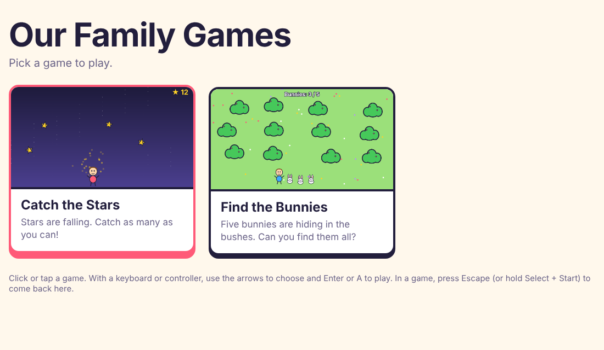
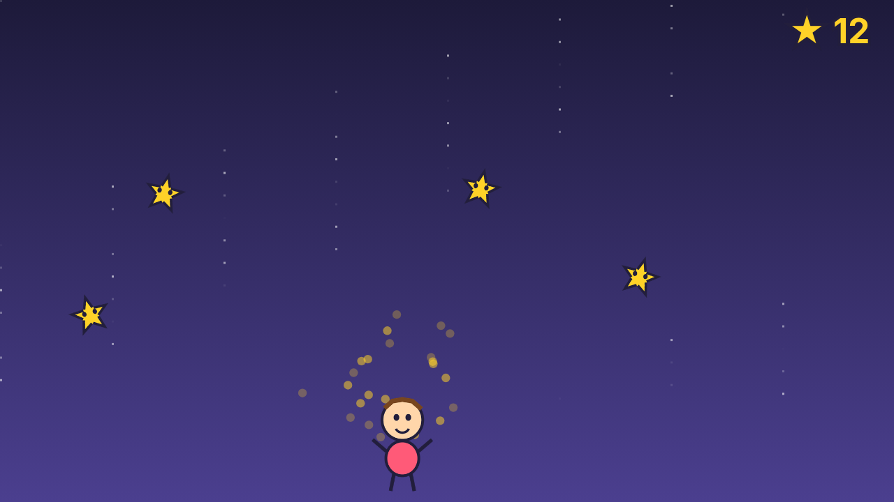
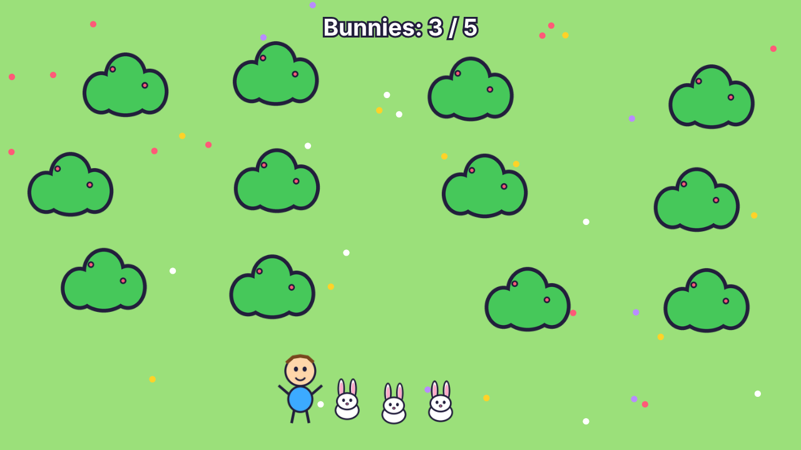

# Make Video Games With Your Kids

Your kid has a game in their head. Maybe it's about a bear who drives a car, or a monkey who has to find all his friends before the clock runs out. With this starter kit and [Claude](https://claude.ai), you can turn their ideas (and their drawings!) into real games that play in a web browser, on a phone, or on a game console like a Steam Deck, and share them with the family at your own web address.

**You don't need to know how to code.** You describe the game in plain words, Claude writes it, and you play it together. If something isn't right, you say so, and Claude changes it.

## What you get

- **A game menu** for your family's games, ready to put online for free.
- **Two example games** to play and pull apart:
  - **Catch the Stars**: move left and right to catch falling stars.
  - **Find the Bunnies**: walk around a meadow and find the bunnies hiding in the bushes.
- **Instructions for Claude** (in `CLAUDE.md`) that tell it how to make kid-friendly games that work with keyboards, game controllers and touch screens, and how to turn your kids' drawings into game pictures.

| Catch the Stars | Find the Bunnies |
| --- | --- |
|  |  |

## What you'll need

- A computer with a web browser. (A phone works for some steps, but setting things up is much easier on a computer.)
- An email address.
- A paid Claude plan (Pro or higher), which includes Claude Code. That's the part that writes the games.
- About an hour for the first-time setup. After that, making a new game or changing one takes as long as your kid wants to keep going.

The other two services you'll use, GitHub and Cloudflare, are free for this.

## The steps

Take them one at a time. Each guide explains every click.

1. **[Make your own copy](docs/1-make-your-copy.md)**: sign up for GitHub and copy this starter kit into your account.
2. **[Put it online](docs/2-put-it-online.md)**: sign up for Cloudflare and give your games their own web address.
3. **[Make a game with Claude](docs/3-make-a-game-with-claude.md)**: describe a game, try it out, and put it on your site.
4. **[Use your kids' drawings](docs/4-use-your-kids-drawings.md)**: turn pictures on paper into characters in the game.
5. **[Tips and troubleshooting](docs/5-tips-and-troubleshooting.md)**: ideas for making games with kids, and what to do when something goes wrong.
6. **[Play on a TV](docs/6-play-on-a-tv.md)**: get your games on the big screen with a game controller, from a quick laptop-and-cable setup to a Steam Deck that feels like a real console.

## Words you'll see

You don't need to understand these deeply. Here's just enough to follow along.

- **GitHub**: a website that stores the files that make up your games, and keeps every past version so nothing is ever really lost.
- **Repository** (or "repo"): your project's folder on GitHub. Your copy of this starter kit will be one.
- **Branch**: a safe side copy of your games where Claude tries out a change without touching the real thing.
- **Pull request**: GitHub's way of saying "here's a change, do you want to keep it?" Clicking **Merge** says yes.
- **Cloudflare Pages**: a free service that takes the files from GitHub and puts them on the web at an address like `our-family-games.pages.dev`. Every time your games change on GitHub, your website updates by itself.
- **Claude Code**: the part of Claude that can read and write the files in your repository. You talk to it in a chat at [claude.ai/code](https://claude.ai/code).

## Questions?

If you get stuck, check [Tips and troubleshooting](docs/5-tips-and-troubleshooting.md). You can also ask Claude itself: paste in the error message or describe what you see, and ask what to do.

The code in this starter kit is free to use and change however you like (see [LICENSE](LICENSE)).
